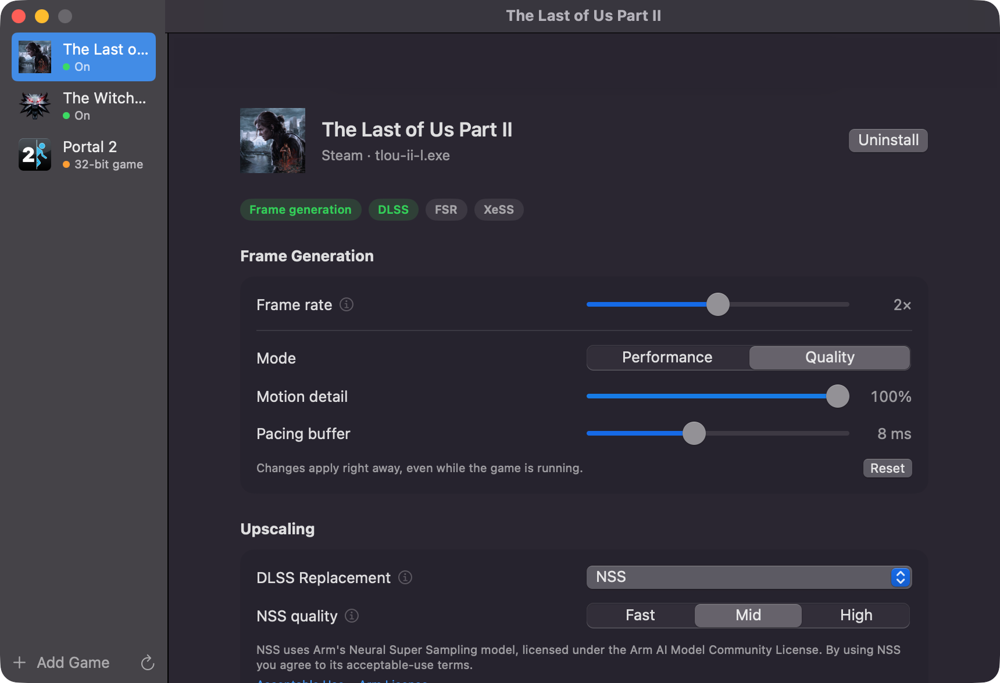

# Lightscale

Lightscale makes Windows games running in CrossOver on Apple silicon Macs smoother and sharper.



- **Frame generation:** generates extra frames between the game's own frames, for 2× or 4× the frame rate. It
  uses Lossless Scaling's LSFG 3.1, running natively on Metal. Needs your own copy of
  [Lossless Scaling on Steam](https://store.steampowered.com/app/993090/).
- **Display scaling, in any game:** run the game at a lower resolution, and Lightscale scales each frame up to the
  window with Lossless Scaling's upscalers (LS1, FSR 1, BCAS, bicubic) or nearest neighbour. Also needs Lossless
  Scaling.
- **Better DLSS:** in games with DLSS, Lightscale can use Arm's
  [Neural Super Sampling](https://huggingface.co/Arm/neural-super-sampling) (NSS) instead of Apple's MetalFX. The
  image is sharper and steadier, for about the same GPU time. Works without Lossless Scaling.
- **Performance HUD:** an overlay with frame rate, frame times, GPU load, power and memory.

## Requirements

- A Mac with Apple silicon (M1 or later)
- macOS 15 Sequoia or later
- [CrossOver](https://www.codeweavers.com/crossover), with your games installed through Steam in a CrossOver bottle
  (other games can be added by their `.exe`)
- Optional: [Lossless Scaling](https://store.steampowered.com/app/993090/) from Steam, installed in a CrossOver bottle,
  for frame generation and display scaling

Lightscale works with 64-bit DirectX games. It leaves out games with anti-cheat, because changing them could get your
account banned, and 32-bit games.

## Install

1. Download `Lightscale-<version>.zip` from the [latest release](https://github.com/MaximKotliar/lightscale/releases/latest).
2. Unzip it and move **Lightscale** to your Applications folder.
3. Open it. Lightscale isn't notarized by Apple, so the first time macOS refuses to open it. Go to **System Settings ›
   Privacy & Security**, scroll down and click **Open Anyway** next to the message about Lightscale.

After that, Lightscale updates itself: when a new version comes out, it shows a banner with an **Update** button.
**Lightscale › Check for Updates…** checks right away.

## Use

1. **Check setup.** On first launch, Lightscale shows a checklist: Apple silicon, CrossOver, and optionally Lossless
   Scaling. Fix anything marked red, then continue. **Check Setup…** (⇧⌘,) opens it again later.
2. **Pick a game.** The sidebar lists the Steam games in all your CrossOver bottles. To add another game, click
   **Add Game** and choose its `.exe`.
3. **Click Install.** This puts Lightscale's hook in the game's folder. **Uninstall** removes it again. Quit the game
   before you install or uninstall.
4. **Choose settings.**
   - **Frame rate:** 2× or 4× turns on frame generation. Off turns it off.
   - **Mode:** *Performance* costs less GPU time; *Quality* looks better.
   - **DLSS Replacement:** NSS or MetalFX, for games with DLSS. Turn DLSS on in the game's graphics settings too.
   - **Display Scaling:** set the game to a lower resolution, then pick an upscaler here.
   - **Performance HUD:** turns the overlay on, with a size slider.
5. **Play.** Start the game from Steam in CrossOver as usual. You can change settings while the game runs, and they
   apply within a second.

Tips:

- Frame generation works best when the game already runs at 40 fps or more. Cap the game's frame rate (for example
  at 60) so that the frame rate stays steady.
- If the Mac gets slower after a few minutes of play, it's probably heat. Set **Energy Mode** to **High Power** in
  System Settings › Battery (or Energy) while you play.
- After you update Lightscale, it may ask to update the hook in your games. Click **Update** when no game is running.

The app keeps its data in `~/Library/Application Support/Lightscale`. The hook writes a log to
`~/Library/Logs/Lightscale.log`, which helps when something doesn't work.

## License

Lightscale is MIT-licensed (see [LICENSE](LICENSE)). It's an independent project, not affiliated with Lossless
Scaling, Arm, Apple or CodeWeavers. Lossless Scaling is not included: Lightscale uses the copy you bought. NSS
ships with Arm's trained weights, which are licensed by Arm under the Arm AI Model Community License, not MIT. Using
NSS means agreeing to its acceptable-use terms, which the app shows next to the NSS setting and under Help.

# For developers

## How it works

Its data lives in `~/Library/Application Support/Lightscale` and the hook logs to `~/Library/Logs/Lightscale.log`. On first launch the app moves the data from the old `lsfg-metal` folder and leaves a link there, so bottles set up before the rename keep working.

- **First launch:** a one-time setup checklist (Apple silicon, CrossOver, the game hook; optionally your Steam copy of Lossless Scaling, with the frame-generation and display-scaling kernels for it). Without Lossless Scaling, NSS/MetalFX and the HUD still work; frame generation and display scaling say they need it. After that, setup only reappears as a small banner if something breaks, for example after a Lossless Scaling update. **Check Setup…** (⇧⌘,) opens it any time.
- **Games:** Steam games from every CrossOver bottle, plus any `.exe` you add with **Add Game** (remembered across launches; right-click to remove). Install picks the right proxy DLL from the game's imports. Games with anti-cheat, 32-bit games, and folders where another mod uses the proxy name are explained and left alone.
- **Per-game profiles:** frame rate Off / 2× / 4×, performance or quality mode, motion detail and pacing buffer for each game. They're stored in each game's folder (`.lsfg/profile.json`, next to the proxy DLL), so every program the game runs shares them, and the hook picks up changes within a second, even mid-game.
- **GPTK picker:** each game can name the Game Porting Toolkit version it should run with, and the app offers to switch CrossOver to it. CrossOver has one GPTK for all bottles, so a switch applies to every game and needs Steam closed. macOS asks once to let the app change CrossOver (App Management). `scripts/build-app.sh` bundles the versions it finds in `GPTK_SOURCES` (default: `~/Applications/CrossOver-GPTK-3.0-backup/apple_gptk` and `~/Applications/GPTK-4.0b3/lib`). They're never committed. A version CrossOver had that the app doesn't carry is saved to `~/Library/Application Support/Lightscale/gptk` before it's replaced.
- **Upscaling:** two settings that stack. *DLSS Replacement* (games with DLSS) runs MetalFX or NSS in place of the game's DLSS. *Display Scaling* (any game) scales the finished frames up to the screen with Lossless Scaling's LS1, FSR, BCAS, bicubic or nearest.
- **Performance HUD:** a per-game switch for an overlay the hook draws in the game's top-left corner, on the final image of every frame on screen (after frame generation and scaling, so it's never interpolated). It shows fps on screen and the game's own fps, a frame-time graph, GPU time for frame generation, the DLSS replacement and the display pass, added latency, GPU load, power draw and memory, and a line on what limits the frame rate. It's drawn with [Dear ImGui](https://github.com/ocornut/imgui) (MIT, `vendor/imgui`).

The app isn't sandboxed, because it edits CrossOver bottles and runs CrossOver's `wine`. It's built with the hardened runtime and no extra entitlements.

## Build

```bash
git clone --recurse-submodules https://github.com/MaximKotliar/lightscale
brew install llvm lld@21 spirv-cross spirv-tools   # the hook's Windows DLLs; kernel baking
DXBC_COMPILER=/path/to/dxbc-spirv/build/tools/dxbc_compiler scripts/build-app.sh   # -> build/Lightscale.app
```

Needs Xcode. The two engines are submodules, pinned to tested commits:

| | |
|---|---|
| [`vendor/lsfg-metal`](https://github.com/MaximKotliar/lsfg-metal) | LSFG 3.1 frame generation on Metal (Swift package; its C API is built for x86_64 for the hook) |
| [`vendor/nss-metal`](https://github.com/MaximKotliar/nss-metal) | Arm Neural Super Sampling on Metal (compiled into the hook) |
| [`vendor/lss-metal`](https://github.com/MaximKotliar/lss-metal) | Lossless Scaling's spatial upscalers on Metal (its C API is built for x86_64 for the hook) |

The build bakes every kernel from this Mac's Lossless.dll (`lsfg-metal bake`): frame generation (SPIR-V) and, with
`DXBC_COMPILER` set ([dxbc-spirv](https://github.com/doitsujin/dxbc-spirv)), the display upscalers (DXBC). Baked
kernels hold none of Lossless Scaling's numbers: weights and other constants are read from each user's own DLL when
a game loads them, so users need no tools and nothing is built on their Mac. They fit the Lossless Scaling versions
they were baked from; an update that changes a shader's structure needs a new build of the app.

Update one with `git -C vendor/nss-metal pull origin main` and commit the new pointer.


## The hook

[hook/README.md](hook/README.md): how it gets into the game through Wine's builtin-DLL mechanism, inserts frames
into D3DMetal's presentation, and swaps MetalFX for NSS.

Notes:

- CrossOver 26's `wineloader` is x86_64, hardened runtime, with `disable-library-validation` but no `allow-dyld-environment-variables`, so `DYLD_INSERT_LIBRARIES` is ignored. The hook gets in through Wine's builtin-DLL mechanism instead.
- The ownership check only confirms that Steam's install files exist. It is not a DRM check.
